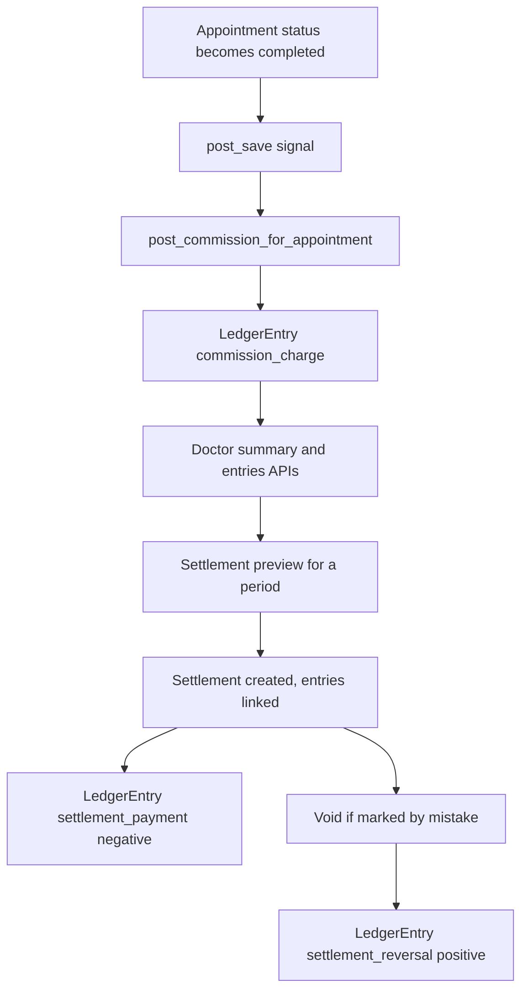

# Doctor-Clinic Payment Ledger (Doctor Portal) - Detailed Plan

## 1. Goal aur business flow

1. Doctor ek ya zyada clinics mein practice karta hai. Har doctor-clinic pair par clinic ka commission set hota hai (percentage ya fixed per visit).
2. Jab appointment `completed` hoti hai, system us visit ka commission ledger mein auto-add kar deta hai. Ye doctor ki taraf se clinic ka baqaya (payable) hai.
3. Doctor portal par weekly aur monthly view milta hai: kitni visits, kitni fee collect hui, clinic ka commission kitna bana, doctor ki net earning kitni, kitna settle ho chuka aur kitna baqi hai.
4. Doctor jab clinic ko payment de deta hai, to portal se us hafte ya mahine ka settlement "mark paid" karta hai. Us period ki sari unsettled entries settled ho jati hain.
5. Galti se mark paid ho jaye to settlement void ho sakti hai. Void se ledger mein reversal entry banti hai, purani entries delete nahi hoti.
6. Admin sab doctors aur clinics ka ledger read-only dekh sakta hai, commission edit kar sakta hai aur adjustment entry daal sakta hai.



## 2. Current state (codebase se)

- Stack: Django 5.2 + DRF + SimpleJWT, timezone `Asia/Karachi`, `USE_TZ=True`, default pagination `StandardPagination` ([config/pagination.py](config/pagination.py)).
- `DoctorClinic` ([catalog/models.py](catalog/models.py)) mein sirf `doctor`, `clinic`, `is_primary`, `created_at` hain. Unique `(doctor, clinic)`.
- `Appointment` ([appointments/models.py](appointments/models.py)): `doctor`, `clinic` (nullable), `status`, `token_date`, `payment_method`, `payment_status`, `payment_amount_expected`, `payment_amount_received`.
- Appointment complete hone ke 2 raaste hain:
  - Doctor: `DoctorAppointmentDetailView.patch` ([catalog/doctor_views.py](catalog/doctor_views.py)), `DoctorAppointmentStatusSerializer` ke zariye.
  - Admin: `AdminAppointmentDetailView` ([appointments/views.py](appointments/views.py)), jo status update kar sakta hai.
  - Dono ko cover karne ke liye signal use hoga, kisi ek view mein hook nahi.
- Doctor routes `doctor_urlpatterns` mein hain ([catalog/urls.py](catalog/urls.py)), `/api/doctor/` par mount. Permission `IsDoctor`, `IsAdmin` ([accounts/permissions.py](accounts/permissions.py)).
- Cash-at-clinic appointments ka `payment_status` hamesha `pending` rehta hai, is liye commission `payment_status` par depend nahi kar sakta. Isi wajah se trigger `completed` rakha gaya hai.
- Test factories pehle se maujood hain: [assistant/tests/factories.py](assistant/tests/factories.py) (`make_doctor`, `make_clinic`, `make_patient`, `make_appointment`, `link_doctor_clinic`). `catalog/tests.py` khali hai.

## 3. Business rules (final)

- **Trigger:** appointment `status == completed` aur `clinic` set ho aur `(doctor, clinic)` ka `DoctorClinic` link maujood ho.
- **Fee base (`resolve_fee_base`):**
  1. `payment_amount_received` agar `payment_status == paid` aur value maujood ho.
  2. Warna `payment_amount_expected`.
  3. Warna `doctor.consultation_fee`.
- **Commission calculation:**
  - `percentage`: `fee_base * value / 100`, 2 decimal places par `ROUND_HALF_UP`.
  - `fixed`: `value`.
  - Commission hamesha `fee_base` se zyada nahi ho sakta (`min(commission, fee_base)`), taake doctor ki earning negative na ho.
  - Agar commission 0 ho ya fee base 0 ho to koi entry nahi banti.
- **Snapshot:** entry mein `fee_base`, `commission_type`, `commission_value`, `payment_method` us waqt ki value ke sath save hoti hain. Baad mein rate ya fee badalne se purani entries nahi badalti.
- **Rate change:** sirf aane wali completed visits par lagta hai.
- **Idempotency:** ek appointment ke liye ek hi `commission_charge` entry ho sakti hai (DB unique constraint).
- **Failed payment:** agar visit complete ho gayi to commission accrue hota hai, chahe `payment_status == failed` ho. Is case ko admin adjustment se theek kiya ja sakta hai.
- **Date bucketing:** weekly aur monthly buckets `entry_date` par hote hain. `entry_date` = appointment ki `token_date` (local date). Week Monday se Sunday tak.
- **Settlement:**
  - Poora period ek sath settle hota hai, partial payment nahi.
  - Settlement amount = us period ki unsettled `commission_charge` aur `adjustment` entries ka total. Client `amount` bhejta hai aur wo server ki computed due se match karna zaroori hai.
  - `period_end` aaj se aage nahi ho sakta. Maximum range 93 din.
  - Agar due <= 0 ho to "Nothing to settle" error.
- **Void:** sirf `paid` settlement void ho sakti hai. Entries dobara unsettled ho jati hain aur ek `settlement_reversal` entry (positive) banti hai.
- **Immutability:** ledger entries edit ya delete nahi hoti. Correction sirf adjustment ya reversal se hogi.
- **Out of scope:** refund aur cancelled-after-complete reversal automatically, clinic ka alag login, payment gateway, frontend UI.

## 4. Models

### 4.1 `DoctorClinic` mein changes ([catalog/models.py](catalog/models.py))

```python
class DoctorClinic(models.Model):
    class CommissionType(models.TextChoices):
        PERCENTAGE = "percentage", "Percentage of fee"
        FIXED = "fixed", "Fixed amount per visit"

    # existing: doctor, clinic, is_primary, created_at
    commission_type = models.CharField(
        max_length=12,
        choices=CommissionType.choices,
        default=CommissionType.PERCENTAGE,
    )
    commission_value = models.DecimalField(
        max_digits=10, decimal_places=2, default=0,
        help_text="Percent (0-100) or PKR per visit, depending on commission_type.",
    )
    commission_updated_at = models.DateTimeField(null=True, blank=True)

    class Meta:
        # existing meta ...
        constraints = [
            models.CheckConstraint(
                condition=models.Q(commission_value__gte=0),
                name="doctorclinic_commission_gte_0",
            ),
            models.CheckConstraint(
                condition=~models.Q(commission_type="percentage")
                | models.Q(commission_value__lte=100),
                name="doctorclinic_percentage_lte_100",
            ),
        ]
```

Migration: `catalog/migrations/0011_doctorclinic_commission.py`. Existing rows ka default `percentage` aur `0` hoga, yani commission tab tak nahi lagega jab tak set na ho.

### 4.2 Naya app `ledger` ([ledger/models.py](ledger/models.py))

```python
class Settlement(models.Model):
    class Status(models.TextChoices):
        PAID = "paid", "Paid"
        VOIDED = "voided", "Voided"

    class PaymentMethod(models.TextChoices):
        CASH = "cash", "Cash"
        BANK_TRANSFER = "bank_transfer", "Bank Transfer"

    doctor = models.ForeignKey("catalog.DoctorProfile", on_delete=models.PROTECT,
                               related_name="ledger_settlements")
    clinic = models.ForeignKey("catalog.Clinic", on_delete=models.PROTECT,
                               related_name="ledger_settlements")
    period_start = models.DateField()
    period_end = models.DateField()
    amount = models.DecimalField(max_digits=12, decimal_places=2)
    status = models.CharField(max_length=10, choices=Status.choices, default=Status.PAID)
    payment_method = models.CharField(max_length=20, choices=PaymentMethod.choices)
    reference = models.CharField(max_length=120, blank=True, default="")
    note = models.TextField(blank=True, default="")
    paid_at = models.DateTimeField(default=timezone.now)
    voided_at = models.DateTimeField(null=True, blank=True)
    void_reason = models.TextField(blank=True, default="")
    created_by = models.ForeignKey(settings.AUTH_USER_MODEL, null=True, blank=True,
                                   on_delete=models.SET_NULL, related_name="+")
    created_at = models.DateTimeField(auto_now_add=True)

    class Meta:
        ordering = ["-paid_at", "-id"]
        indexes = [models.Index(fields=["doctor", "clinic", "period_start"])]
        constraints = [
            models.CheckConstraint(condition=models.Q(amount__gt=0),
                                   name="settlement_amount_gt_0"),
            models.CheckConstraint(condition=models.Q(period_end__gte=models.F("period_start")),
                                   name="settlement_period_valid"),
        ]


class LedgerEntry(models.Model):
    class EntryType(models.TextChoices):
        COMMISSION_CHARGE = "commission_charge", "Commission charge"
        SETTLEMENT_PAYMENT = "settlement_payment", "Settlement payment"
        SETTLEMENT_REVERSAL = "settlement_reversal", "Settlement reversal"
        ADJUSTMENT = "adjustment", "Adjustment"

    doctor = models.ForeignKey("catalog.DoctorProfile", on_delete=models.PROTECT,
                               related_name="ledger_entries")
    clinic = models.ForeignKey("catalog.Clinic", on_delete=models.PROTECT,
                               related_name="ledger_entries")
    appointment = models.ForeignKey("appointments.Appointment", null=True, blank=True,
                                    on_delete=models.SET_NULL, related_name="ledger_entries")
    settlement = models.ForeignKey(Settlement, null=True, blank=True,
                                   on_delete=models.PROTECT, related_name="entries")
    entry_type = models.CharField(max_length=24, choices=EntryType.choices)
    entry_date = models.DateField(db_index=True)
    # signed: charge/adjustment(+) increases what doctor owes, payment(-) reduces it
    amount = models.DecimalField(max_digits=12, decimal_places=2)
    # snapshots (commission_charge only)
    fee_base = models.DecimalField(max_digits=10, decimal_places=2, null=True, blank=True)
    commission_type = models.CharField(max_length=12, blank=True, default="")
    commission_value = models.DecimalField(max_digits=10, decimal_places=2, null=True, blank=True)
    payment_method = models.CharField(max_length=20, blank=True, default="")
    note = models.TextField(blank=True, default="")
    created_by = models.ForeignKey(settings.AUTH_USER_MODEL, null=True, blank=True,
                                   on_delete=models.SET_NULL, related_name="+")
    created_at = models.DateTimeField(auto_now_add=True)

    class Meta:
        ordering = ["entry_date", "id"]
        indexes = [
            models.Index(fields=["doctor", "clinic", "entry_date"]),
            models.Index(fields=["doctor", "settlement"]),
        ]
        constraints = [
            models.UniqueConstraint(
                fields=["appointment", "entry_type"],
                condition=models.Q(appointment__isnull=False),
                name="uniq_ledger_entry_per_appointment_type",
            ),
            models.CheckConstraint(
                condition=models.Q(entry_type="commission_charge", amount__gt=0)
                | models.Q(entry_type="settlement_payment", amount__lt=0)
                | models.Q(entry_type="settlement_reversal", amount__gt=0)
                | models.Q(entry_type="adjustment"),
                name="ledger_amount_sign_matches_type",
            ),
        ]
```

Design notes:
- `PROTECT` isliye ki doctor ya clinic delete hone par financial history ghayab na ho.
- Balance (doctor owes clinic) = `Sum(amount)` filter `doctor`, `clinic`.
- `is_settled` ek derived property hai: `settlement_id is not None` (sirf `commission_charge` aur `adjustment` ke liye meaningful).
- Naya app `ledger` register hoga: `ledger/apps.py` (`LedgerConfig.ready()` mein signals import), `ledger/admin.py` (read-only admin for both models).
- Migration: `ledger/migrations/0001_initial.py`, dependency `catalog.0011`, `appointments` latest.

## 5. Services ([ledger/services.py](ledger/services.py))

- `resolve_fee_base(appointment) -> Decimal`: section 3 ke rules.
- `calculate_commission(fee_base, commission_type, commission_value) -> Decimal`: rounding aur cap ke sath.
- `post_commission_for_appointment(appointment) -> LedgerEntry | None`
  - Skip conditions: status completed nahi, clinic nahi, `DoctorClinic` nahi, commission 0.
  - `transaction.atomic` + `get_or_create` (unique constraint par race-safe, `IntegrityError` pakad kar existing entry return).
  - `entry_date = appointment.token_date`.
- `post_adjustment(doctor, clinic, amount, entry_date, note, user)`: admin ke liye, `amount` non-zero, note zaroori.
- `get_settlement_preview(doctor, clinic, period_start, period_end) -> dict`: `due_amount`, `entries_count`, `visits_count`, `gross_collected`, `commission_total`, `adjustments_total`.
- `create_settlement(doctor, clinic, period_start, period_end, amount, payment_method, reference, note, user) -> Settlement`
  - `transaction.atomic`, unsettled entries par `select_for_update()`.
  - Validation: clinic doctor ka linked ho, `period_end <= aaj`, range <= 93 din, due > 0, `amount == due`.
  - Entries ka `settlement` set karta hai aur ek `settlement_payment` entry (`-due`, `entry_date = aaj`) banata hai.
- `void_settlement(settlement, user, reason)`
  - `transaction.atomic`, sirf `paid` status.
  - Linked charge/adjustment entries ka `settlement = None`, settlement `voided`, `voided_at` set, aur ek `settlement_reversal` entry (`+amount`).
  - `settlement_payment` aur `settlement_reversal` entries `settlement` FK par linked rehti hain (history ke liye).

Custom exceptions: `LedgerError(detail)` subclass (`NothingToSettle`, `AmountMismatch`, `InvalidPeriod`), jinhe views DRF `ValidationError` (400) mein convert karte hain.

## 6. Signals aur backfill

- [ledger/signals.py](ledger/signals.py): `post_save` on `Appointment`. Agar `instance.status == COMPLETED` to `post_commission_for_appointment(instance)` call hota hai. Poora call `try/except` mein, errors `logging.exception` hote hain, taake ledger ka masla visit completion na rok de.
- Ye signal har save par chalega jab status completed ho, lekin unique constraint ki wajah se duplicate nahi banega.
- Management command [ledger/management/commands/backfill_ledger.py](ledger/management/commands/backfill_ledger.py):
  - Options: `--doctor <id>`, `--since YYYY-MM-DD`, `--dry-run`.
  - Sab completed appointments par `post_commission_for_appointment` chalata hai aur created/skipped counts print karta hai.
  - Missing entries (jo signal fail hone ki wajah se reh gayi hon) ki repair ke liye bhi use hoga.

## 7. Reports ([ledger/reports.py](ledger/reports.py))

- `period_bounds(period, any_date) -> (start, end)`: weekly Monday-Sunday, monthly calendar month.
- `build_summary(doctor, period, date_from, date_to, clinic=None)`:
  - `TruncWeek` / `TruncMonth` on `entry_date`, sirf `commission_charge` aur `adjustment` entries.
  - Har bucket mein: `visits` (charge count), `gross_collected` (`Sum(fee_base)`), `gross_by_method` (bank_transfer, cash_at_clinic), `commission_total` (charge sum), `adjustments_total`, `net_earnings` = gross - commission - adjustments, `settled_total` (settlement set wali entries), `outstanding` (settlement null wali entries), `is_fully_settled`.
  - Default range: weekly = pichle 8 hafte, monthly = pichle 6 mahine.
- `clinic_balances(doctor)`: har clinic ka `Sum(amount)` (total outstanding) + commission rate.
- `entries_queryset(doctor, filters)`: `running_balance` ek correlated `Subquery` se (same doctor/clinic, `(entry_date, id) <= current`), taake filters se running balance na bigde.

## 8. API design

### 8.1 Doctor portal (`/api/doctor/ledger/`, `IsDoctor`, sab queries `request.user.doctor_profile` se scoped)

- `GET /api/doctor/ledger/summary/`
  - Query: `period` (`weekly` | `monthly`, default `weekly`), `date_from`, `date_to`, `clinic` (id).
  - Response:

```json
{
  "period": "weekly",
  "date_from": "2026-08-17",
  "date_to": "2026-10-11",
  "buckets": [
    {
      "period_start": "2026-10-05",
      "period_end": "2026-10-11",
      "visits": 18,
      "gross_collected": "36000.00",
      "gross_by_method": {"bank_transfer": "24000.00", "cash_at_clinic": "12000.00"},
      "commission_total": "7200.00",
      "adjustments_total": "0.00",
      "net_earnings": "28800.00",
      "settled_total": "0.00",
      "outstanding": "7200.00",
      "is_fully_settled": false
    }
  ],
  "totals": { "visits": 90, "gross_collected": "...", "commission_total": "...",
              "net_earnings": "...", "settled_total": "...", "outstanding": "..." }
}
```

- `GET /api/doctor/ledger/entries/`
  - Query: `clinic`, `date_from`, `date_to`, `entry_type`, `settled` (`true` | `false`), `page`, `page_size`.
  - Har row: `id`, `entry_date`, `entry_type`, `amount`, `fee_base`, `commission_type`, `commission_value`, `payment_method`, `appointment` (`id`, `token_code`, `patient_name`), `clinic` (`id`, `name`), `settlement_id`, `running_balance`, `note`.
- `GET /api/doctor/ledger/balance/`
  - Clinic-wise: `clinic`, `commission_type`, `commission_value`, `outstanding_balance`, `last_settlement_at`. Plus `total_outstanding`.
- `GET /api/doctor/ledger/settlements/`: list (filters `clinic`, `status`). Har item mein period, amount, method, reference, status.
- `GET /api/doctor/ledger/settlements/preview/?clinic=&period_start=&period_end=`: `get_settlement_preview` ka result (UI confirm screen ke liye).
- `POST /api/doctor/ledger/settlements/`
  - Body: `clinic`, `period_start`, `period_end`, `amount`, `payment_method`, `reference`, `note`.
  - Success 201: settlement object. Errors 400: nothing to settle, amount mismatch, invalid period, clinic not linked.
- `POST /api/doctor/ledger/settlements/<id>/void/`: body `reason` (required). 200 par updated settlement. Already voided ho to 400.
- Existing `GET /api/doctor/clinics/` aur `.../clinics/<id>/`:
  - `DoctorClinicSerializer` mein add: `commission_type`, `commission_value`, `outstanding_balance`.
  - `DoctorClinicCreateSerializer` aur `DoctorClinicUpdateSerializer` mein optional `commission_type`, `commission_value` (validation: value >= 0, percentage ke liye <= 100). Update par `commission_updated_at = now`.

### 8.2 Admin (`/api/admin/ledger/`, `IsAdmin`)

- `GET entries/`: filters `doctor`, `clinic`, `entry_type`, `date_from`, `date_to`, `settled`, paginated.
- `GET settlements/`: filters `doctor`, `clinic`, `status`, `date_from`, `date_to`.
- `GET commissions/`: sab `DoctorClinic` pairs ka commission aur outstanding balance.
- `PATCH commissions/<doctor_clinic_id>/`: `commission_type`, `commission_value` edit.
- `POST adjustments/`: `doctor`, `clinic`, `amount` (+/-), `entry_date`, `note`.
- `GET summary/?doctor=<id>`: doctor wala summary shape, kisi bhi doctor ke liye.

### 8.3 Wiring

- [config/settings.py](config/settings.py): `INSTALLED_APPS` mein `"ledger"`.
- [catalog/urls.py](catalog/urls.py): `doctor_urlpatterns` mein `path("ledger/", include("ledger.doctor_urls"))`.
- [config/urls.py](config/urls.py): `path("api/admin/ledger/", include("ledger.admin_urls"))` `api/admin/` wali catalog line se pehle.
- Files: `ledger/serializers.py`, `ledger/doctor_views.py`, `ledger/admin_views.py`, `ledger/doctor_urls.py`, `ledger/admin_urls.py`.

## 9. Test cases

Location: `ledger/tests/` package. Base `APITestCase` + `force_authenticate`. Helpers file `ledger/tests/helpers.py` jo [assistant/tests/factories.py](assistant/tests/factories.py) ko reuse karti hai aur ye add karti hai: `set_commission(doctor, clinic, type, value)`, `complete_appointment(doctor, clinic, token_date, fee, ...)`, `make_admin()`.

### 9.1 `test_models.py`
- `DoctorClinic` percentage 100.01 reject (IntegrityError).
- `DoctorClinic` negative commission reject.
- `LedgerEntry` duplicate `(appointment, commission_charge)` reject.
- `LedgerEntry` commission_charge negative amount reject; settlement_payment positive reject.
- `Settlement` amount <= 0 reject; `period_end < period_start` reject.
- Multiple entries with `appointment=NULL` allowed (unique constraint conditional hai).
- Doctor delete `PROTECT` ki wajah se ledger entries hone par fail.

### 9.2 `test_calculation.py` (`calculate_commission`, `resolve_fee_base`)
- Percentage: 2000 @ 20% = 400.00.
- Percentage rounding: 999.99 @ 12.5% = 125.00 (`ROUND_HALF_UP`).
- Fixed: 2000 @ 300 = 300.00.
- Fixed cap: fee 200 @ fixed 300 = 200.00.
- Zero commission value = 0.
- Fee base: paid + received=1800 (expected=2000) = 1800.
- Fee base: pending cash + expected=2000 = 2000.
- Fee base: no expected, no received = `doctor.consultation_fee`.
- Fee base: payment failed + expected set = expected.

### 9.3 `test_posting.py` (`post_commission_for_appointment`)
- Completed appointment, 20% rate: ek `commission_charge` entry, amount 400, snapshots sahi (`fee_base`, `commission_type`, `commission_value`, `payment_method`), `entry_date == token_date`.
- Upcoming/cancelled/rejected appointment par entry nahi banti.
- Clinic null ho to skip.
- `DoctorClinic` link na ho to skip.
- Commission value 0 ho to skip.
- Function do dafa call karne par sirf ek entry (idempotent).
- Rate change ke baad naya appointment complete karo: purani entry ka amount nahi badalta, nayi entry nayi rate se.
- Fee change (`consultation_fee`) ke baad purani entry nahi badalti.
- Do clinics wala doctor: har appointment apni clinic ke rate se post hoti hai.
- Race: `IntegrityError` par existing entry return hoti hai (create mock se simulate).

### 9.4 `test_signals.py`
- Appointment `status=completed` save karne par entry auto-create.
- Doctor PATCH `/api/doctor/appointments/<id>/` `{"status": "completed"}` par entry create.
- Admin PATCH appointment status completed par entry create.
- Completed appointment dobara save (notes edit) par duplicate nahi.
- Service exception aaye to appointment save/completion fail nahi hoti aur error log hota hai.
- Rejected status par entry nahi.

### 9.5 `test_backfill.py`
- Purani completed appointments par command chalane se entries banti hain.
- Dobara chalane par 0 new entries.
- `--dry-run` DB mein kuch nahi likhta.
- `--doctor` aur `--since` filters sahi kaam karte hain.

### 9.6 `test_summary_api.py` (`GET /api/doctor/ledger/summary/`)
- Weekly bucketing: Monday aur Sunday ki visits ek hi bucket mein, agle Monday ki visit agle bucket mein.
- Monthly bucketing: 31 Oct aur 1 Nov alag buckets mein.
- Bucket math: visits, gross, commission, net, outstanding sahi.
- `gross_by_method` bank_transfer aur cash_at_clinic ka sahi split.
- Settled bucket: `settled_total` set, `outstanding` 0, `is_fully_settled` true.
- Partially settled (period ke andar nahi) alag bucket sahi dikhta hai.
- `clinic` filter sirf us clinic ka data.
- `date_from`/`date_to` range ke bahar ki entries exclude.
- Default range: weekly 8 hafte, monthly 6 mahine.
- Invalid `period` par 400.
- Adjustments `adjustments_total` aur `net_earnings` mein reflect.
- Empty ledger par buckets khali aur totals `"0.00"`.
- Doctor B ka data doctor A ki summary mein nahi.

### 9.7 `test_entries_api.py`
- List pagination aur ordering (`entry_date`, `id`).
- Filters: `clinic`, `entry_type`, `settled=true/false`, date range.
- `running_balance` sahi (charge, charge, payment ke baad) aur filter lagane par bhi wohi rehta hai.
- Row mein appointment `token_code` aur patient name hain.
- Doctor sirf apni entries dekhta hai.

### 9.8 `test_balance_api.py`
- Clinic-wise outstanding balance sahi, aur `total_outstanding` unka sum.
- Settlement ke baad balance ghat jata hai, void ke baad wapas barh jata hai.
- Commission rate response mein aata hai.

### 9.9 `test_settlement_api.py`
- Preview: due, visits, gross, commission sahi; koi write nahi hota.
- POST success: 201, settlement `paid`, period ki charge entries linked, ek negative `settlement_payment` entry, balance 0.
- Period ke bahar ki entries settle nahi hoti.
- Amount mismatch par 400, koi change nahi.
- Zyada amount (overpay) par 400.
- Dobara same period par POST: 400 "Nothing to settle" (double-pay protection).
- Future `period_end` par 400.
- `period_end < period_start` par 400.
- Range 93 din se zyada par 400.
- Doctor ki unlinked clinic par 400/404.
- Doosre doctor ki clinic/settlement ID use karne par 404.
- Invalid `payment_method` par 400.
- Adjustment entries (unsettled) us period ke settlement mein include hoti hain.
- Concurrent double POST (do sequential calls with `select_for_update` path): sirf ek succeed.
- Void: 200, status `voided`, entries unsettled, `settlement_reversal` entry (+amount), balance wapas.
- Void bina reason ke 400; already voided par 400; doosre doctor ki settlement void par 404.
- Void ke baad same period dobara settle ho sakta hai.
- Settlement list: filters `clinic`, `status`; sirf apni settlements.

### 9.10 `test_clinic_commission_api.py`
- `GET /api/doctor/clinics/` mein `commission_type`, `commission_value`, `outstanding_balance` hain.
- PATCH clinic link par commission update, `commission_updated_at` set.
- Percentage > 100 par 400; negative par 400.
- Create clinic ke sath commission set ho sakta hai.
- Commission update ka asar sirf naye completed appointments par.

### 9.11 `test_permissions.py`
- Unauthenticated: 401 sab ledger endpoints par.
- Patient role: 403.
- Admin role ko doctor ledger endpoints par 403 (admin apni routes use karta hai).
- Doctor ko admin ledger endpoints par 403.

### 9.12 `test_admin_api.py`
- Entries/settlements list filters (`doctor`, `clinic`, date range).
- Commissions list aur PATCH.
- Adjustment POST: entry banti hai, balance badalta hai; note ke baghair 400; zero amount par 400.
- Admin summary kisi bhi doctor ke liye.
- Adjustment settlement preview mein include hoti hai.

Total approx 110 tests. Run: `python manage.py test ledger catalog appointments` (pehle se maujood tests regress na hon).

## 10. Implementation order

1. `catalog` fields + migration, serializers (clinic commission fields) aur unke tests.
2. `ledger` app: models, migration, admin, model tests.
3. Calculation aur posting service + tests.
4. Signal aur backfill command + tests.
5. Reports aur summary/entries/balance APIs + tests.
6. Settlement preview/create/void + tests.
7. Admin APIs + permission tests.
8. Poori test suite chalana aur existing tests ke sath regression check.

## 11. Risks aur edge cases

- **Signal failure silently miss ho sakta hai:** log hota hai aur `backfill_ledger` se repair hota hai.
- **Cash visits par collection ka track nahi:** commission expected fee par bante hain, kyunki system cash collection kabhi mark nahi karta.
- **Completed ke baad status badalna:** koi auto-reversal nahi, admin adjustment se theek hoga (out of scope documented).
- **Doctor khud commission rate set karta hai:** clinic ka login nahi hai, is liye admin ke paas override hai aur `commission_updated_at` audit ke liye save hota hai.
- **Rounding:** sab calculations `Decimal` mein, float kabhi nahi.
- **Legacy `DoctorProfile.clinic` FK:** posting `DoctorClinic` par depend karti hai, jo legacy FK se auto-mirror hota hai ([catalog/doctor_views.py](catalog/doctor_views.py) `DoctorClinicListCreateView`). Backfill command missing links ko skip karke report karti hai.
