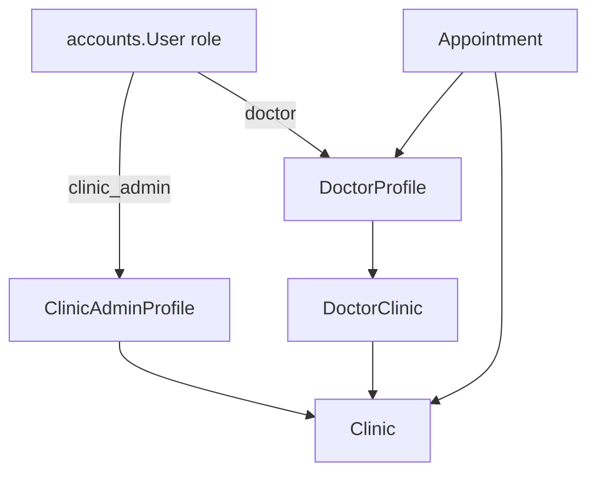
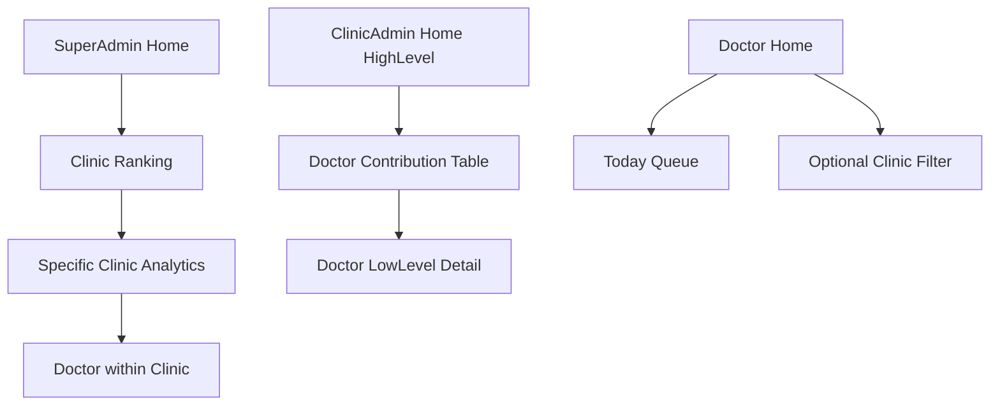

# Analytics Implementation Plan (Roman Urdu)

## 1. Executive Summary

Is project mein analytics zyada tar **pehli se maujood data** se ban sakta hai. Naya database schema almost zaroori nahi.

- Stack: **Django + DRF + SimpleJWT**
- Core data: `Appointment`, `Clinic`, `DoctorProfile`, `DoctorClinic`
- Appointment status: `upcoming`, `completed`, `cancelled`, `rejected` (koi `pending` status nahi)
- Abhi dashboards partial hain:
  - Super Admin: billing KPIs only ([billing/views.py](billing/views.py) `SuperadminDashboardView`)
  - Clinic Admin: **koi dedicated dashboard endpoint nahi** — yeh sab se bada gap
  - Doctor: aaj ke counts ([catalog/doctor_views.py](catalog/doctor_views.py) `DoctorDashboardView`)
  - Clinic doctor detail pe limited stats, lekin sirf **last 50 appointments** ([billing/clinic_doctors.py](billing/clinic_doctors.py))

**Approach (locked):**
- Shared helpers: [`appointments/analytics.py`](appointments/analytics.py)
- Naya clinic dashboard + superadmin drill-down endpoints
- Existing dashboard responses **backward compatible** extend (purane fields mat hatao)
- Har naya change ke sath **detailed tests + regression tests**

---

## 2. Existing Architecture (verified)



**Isolation already kaam karti hai:**
- Clinic Admin: `_clinic_for(request)` → `request.user.clinic_admin_profile.clinic` ([billing/views.py](billing/views.py))
- Doctors/appointments clinic-scoped: `_clinic_doctors_qs`, `_clinic_appointments_qs`
- Permissions: `IsSuperAdmin`, `IsClinicAdmin`, `IsDoctor` ([accounts/permissions.py](accounts/permissions.py))

---

## 3. Teeno Panels — UI/UX Idea + Step-by-step kya dikhega

Yeh section product/frontend clarity ke liye hai. Backend JSON dega; frontend cards/tables/charts render karega.



---

### 3.1 Super Admin Panel — High Level (platform home)

**Screen:** Super Admin Dashboard (existing billing cards + naye ops cards)

**Upar billing section (pehle se hai — mat todo):**
- Active subscriptions
- Pending purchase requests
- Active packages
- Active clinics
- Cash collected this month (SaaS billing)
- Recent payments / pending requests lists

**Neeche naya “Platform Appointments” section:**
1. Card: **Total Appointments** (poori platform)
2. Card: **Total Active Doctors**
3. Card: **Total Active Clinics** (already billing mein ho sakta hai — duplicate mat dikhao; ek jagah clear label)
4. Status strip / 4 chhote cards:
   - Upcoming
   - Completed
   - Cancelled
   - Rejected
5. **Top Clinics by Appointments** table (top 5–10):
   - Clinic name
   - Appointment count
   - Platform contribution %
   - Doctors count
   - Row click → clinic detail analytics

**Filters (top bar):**
- Date: Today / This week / This month / Custom `date_from`–`date_to`
- Default: all-time ya current month (implement mein **current month** default rakho taake dashboard useful lage)

**UI tone:** Platform overview — pehle “kitni clinics chal rahi hain + kitni bookings”, phir ranking.

---

### 3.2 Super Admin — Specific Clinic pe click karke kya dikhega

**Navigation:** Dashboard → Top Clinics row / Clinics list → **Clinic Analytics**

**Clinic header:**
- Clinic name, city/area, active/inactive badge
- Quick links: billing detail (existing clinic page), analytics (current)

**High-level clinic cards (us clinic ke liye):**
1. Total doctors linked (`DoctorClinic`)
2. Total appointments
3. Unique patients (distinct `patient_id`)
4. Status breakdown (upcoming/completed/cancelled/rejected)
5. Today upcoming (agar date filter all-time ho to alag “Today” mini-card)

**Main block — Doctor Contribution (sab se important):**
| Doctor | Total Appts | Share % | Completed | Cancelled | Rejected | Upcoming |
|--------|-------------|---------|-----------|-----------|----------|----------|
| Dr A   | 50          | 50%     | 40        | 5         | 2        | 3        |
| Dr B   | 30          | 30%     | ...       | ...       | ...      | ...      |

- Sorted by total appts desc
- Top doctor highlight (badge: “Highest volume”)
- Bottom doctor highlight optional (“Lowest volume” among doctors with >0, ya including zero-booking doctors)

**Secondary:**
- Bar chart: doctor vs appointment count
- Pie chart: status mix for this clinic
- Empty doctors (linked but 0 appointments) list — clinic performance gap samajhne ke liye

**Doctor row click (optional Phase 2):**
- Us doctor+clinic ka status detail
- Recent appointments sample (link to existing lists, naya heavy UI mat banao)

**Important:** Super Admin yahan **dusri clinics compare** kar sakta hai; Clinic Admin bilkul nahi.

---

### 3.3 Clinic Admin Panel — High Level (apni clinic home)

Yeh pehle plan mein kam tha — ab **full high-level + low-level** clear hai.

**Screen:** `Clinic Dashboard` (naya — abhi backend endpoint missing)

**Top header:**
- Clinic name (from `GET /api/clinic/me/` already)
- Date filter chips: Today / 7 days / Month / Custom
- Package lock badge (existing `access_locked`) — stats **phir bhi readable** (dashboard read unlocked)

**Section A — Snapshot cards (high level):**
1. **Total Doctors** — active linked doctors
2. **Total Appointments** — selected date range
3. **Completed Appointments**
4. **Upcoming (Today)** — aaj ke pending visits
5. **Cancelled + Rejected** (ek card ya do)
6. **Unique Patients** — range ke andar distinct patients

**Section B — Status overview:**
- Horizontal status bars ya 4 mini donuts:
  - upcoming / completed / cancelled / rejected
- Label clearly: “Appointment activity” (revenue nahi)

**Section C — Doctor performance (high-level ranking):**
- Table + progress bar for % share
- Columns:
  - Doctor name
  - Speciality (agar easy ho existing serializer se)
  - Appointments
  - Contribution %
  - Completed count
  - Cancel rate = cancelled/total for that doctor (optional Phase 2)
- Badges:
  - Highest volume
  - Lowest volume (among doctors with appointments, aur alag “No bookings yet”)

**Section D — Quick actions (existing routes, naya invent mat karo):**
- View all appointments → `/api/clinic/appointments/`
- Manage doctors → `/api/clinic/doctors/`
- Click doctor row → **Low-level doctor analytics**

**UI tone:** Clinic manager ko 10 second mein pata chal jaye “kaun busy hai, aaj kitne patients hain, cancel kitne hain”.

---

### 3.4 Clinic Admin — Low Level (specific doctor ke andar)

**Entry:** Dashboard doctor row → existing enriched doctor detail page extend  
Endpoint reuse/extend: `GET /api/clinic/doctors/<uuid>/` + analytics helpers (full counts, not last-50 only for summary stats)

**Low-level doctor page blocks:**

1. **Doctor header**
   - Name, fee, active, commission summary (already in `build_detail_payload`)

2. **Stats strip (FULL range, not last 50)**
   - Total appointments (this clinic only)
   - Upcoming / Completed / Cancelled / Rejected
   - Contribution % of clinic total (same date filter)
   - Unique patients
   - Today upcoming count

3. **Trend-lite (Phase 2)**
   - Last 7 days appointment counts (simple list of `{date, count}`) — chart frontend pe

4. **Patients list** (already partially exists)
   - Name, phone, visit_count — keep

5. **Recent appointments table** (existing last N list OK for table UI)
   - Lekin summary numbers last-50 se mat nikalna — summary alag full aggregate

6. **Commission / earnings block (Phase 3 only)**
   - Gross fees / clinic share / doctor share
   - Label: “Estimated from completed appointments” — popularity mat bolo

**Clinic Admin kabhi na dekhe:**
- Dusri clinic ka koi card, ranking, ya compare
- Platform-wide totals

---

### 3.5 Doctor Panel — UI/UX

**Screen:** existing Doctor Dashboard extend

**High level:**
1. Aaj: Upcoming / Completed / Rejected (already)
2. Future bookings (already)
3. Total patients seen (already)
4. **Naya:** Overall status totals (all-time or month)
5. **Naya (multi-clinic doctors):** Clinic filter dropdown — “All my clinics” / specific clinic
6. Chhoti list: aaj ke upcoming appointments (already)

**Low level:**
- Existing appointments list filters (`status`, `today`, dates) — analytics se deep link
- Optional “My share in clinic X” sirf tab jab clinic filter selected ho (Phase 2) — doctor ko clinic-internal ranking dikhana sensitive ho sakta hai; **default: mat dikhao ranking vs other doctors**. Sirf apni counts.

**UI tone:** Personal ops board — “aaj kya pending hai”, competition leaderboard nahi.

---

## 4. Clinic Admin Stats — Complete Inventory (High + Low)

### High-level (`GET /api/clinic/dashboard/`)

| Field | Meaning | Source |
|-------|---------|--------|
| `clinic_id`, `clinic_name` | kaunsi clinic | `ClinicAdminProfile.clinic` |
| `total_doctors` | linked active doctors | `DoctorClinic` + `DoctorProfile.is_active` |
| `total_appointments` | range ke andar | `Appointment.clinic=...` |
| `status_counts.upcoming/completed/cancelled/rejected` | status mix | `Appointment.status` |
| `today_upcoming` | aaj ke upcoming | `token_date=today`, status upcoming |
| `unique_patients` | distinct patients | `patient_id` distinct |
| `doctor_contributions[]` | har doctor volume + % | group by doctor |
| `top_doctor` / `lowest_doctor` | convenience fields | from contributions |
| `doctors_with_zero_appointments` | linked but idle | DoctorClinic minus contributors |
| `date_from`, `date_to` | applied filter echo | query params |

**Query params:** `date_from`, `date_to`, `today`, optional `status` (contribution basis)

### Low-level (doctor detail analytics part)

| Field | Meaning |
|-------|---------|
| Same status counts but `doctor + clinic` scoped | |
| `contribution_percentage` vs clinic total | |
| `unique_patients` | |
| `today_upcoming` | |
| `recent_appointments` (list, limited) | UI table |
| Phase 3: earnings fields | labelled separately |

**Response example — Clinic high level:**

```json
{
  "clinic_id": 3,
  "clinic_name": "Fatimiyah Clinic",
  "filters": {"date_from": "2026-11-01", "date_to": "2026-11-30"},
  "total_doctors": 5,
  "total_appointments": 100,
  "unique_patients": 72,
  "today_upcoming": 8,
  "status_counts": {
    "upcoming": 20,
    "completed": 60,
    "cancelled": 15,
    "rejected": 5
  },
  "top_doctor": {"name": "Dr A", "appointment_count": 50, "percentage": 50.0},
  "lowest_doctor": {"name": "Dr C", "appointment_count": 20, "percentage": 20.0},
  "doctors_with_zero_appointments": [{"name": "Dr E", "doctor_uuid": "..."}],
  "doctor_contributions": [
    {
      "doctor_uuid": "...",
      "name": "Dr A",
      "appointment_count": 50,
      "percentage": 50.0,
      "status_counts": {"upcoming": 3, "completed": 40, "cancelled": 5, "rejected": 2}
    }
  ]
}
```

---

## 5. Super Admin + Doctor — Metrics (short but complete)

### Super Admin platform
- Billing KPIs (unchanged keys)
- Appointment totals + status_counts
- `clinic_rankings[]`: clinic_id, name, appointment_count, percentage, doctors_count

### Super Admin clinic detail
- Same shape as Clinic Admin high-level (reuse helper!), plus clinic identity
- Doctor contributions identical helper `doctor_contributions(clinic, filters)`

### Doctor
- Keep all existing keys
- Add: `status_counts` overall
- Add optional: `clinic_id` filter echo
- **Do not** add other-doctors ranking by default

---

## 6. Contribution Formula

Clinic total = 100:
- A 50 → 50%, B 30 → 30%, C 20 → 20%

```python
total = qs.count()
rows = qs.values(...).annotate(appointment_count=Count("id")).order_by("-appointment_count")
percentage = round(100 * count / total, 1) if total else 0.0
```

Default basis = **all statuses**. Completed-only alag filter se.

---

## 7. API Endpoints (concrete)

| Method | Path | Role | Purpose |
|--------|------|------|---------|
| GET | `/api/clinic/dashboard/` | Clinic Admin | High-level clinic analytics |
| GET | `/api/clinic/doctors/<uuid>/` | Clinic Admin | Low-level (extend stats to full aggregates) |
| GET | `/api/superadmin/dashboard/` | Super Admin | Extend with appointment KPIs (compat) |
| GET | `/api/superadmin/analytics/clinics/` | Super Admin | Clinic rankings |
| GET | `/api/superadmin/analytics/clinics/<pk>/` | Super Admin | Clinic detail = clinic-admin-like payload |
| GET | `/api/doctor/dashboard/` | Doctor | Extend status totals (+ optional clinic) |

Permissions:
- Clinic dashboard: `IsClinicAdmin` only (package lock **mat** lagao on GET dashboard)
- Superadmin analytics: `IsSuperAdmin`
- Doctor: `IsDoctor`

---

## 8. File-by-file Implementation

| File | Kaam |
|------|------|
| Naya [`appointments/analytics.py`](appointments/analytics.py) | `apply_date_filters`, `status_counts`, `doctor_contributions`, `clinic_rankings`, `unique_patients` |
| [`billing/views.py`](billing/views.py) | `ClinicDashboardView`; extend `SuperadminDashboardView`; add superadmin analytics views |
| [`billing/urls.py`](billing/urls.py) | routes |
| [`billing/clinic_doctors.py`](billing/clinic_doctors.py) | summary stats full aggregate; recent list limit alag |
| [`catalog/doctor_views.py`](catalog/doctor_views.py) | doctor dashboard extend |
| Naya tests (neeche detail) | new + regression |

**DB migration:** Phase 1–2 nahi.

**Backward compatibility rule:** Existing dashboard JSON keys delete/rename mat karo — sirf naye keys add.

---

## 9. Detailed Testcases (naya + regression)

Goal: naya analytics aaye **aur** purana billing/clinic/doctor flow break na ho.

Existing patterns reuse: `APITestCase`, `assistant.tests.factories` (`make_clinic`, `make_doctor`, `make_appointment`, `make_patient`), clinic admin helper jaisa [`billing/tests/test_clinic_doctor_detail.py`](billing/tests/test_clinic_doctor_detail.py).

### 9.1 Naye files

- `appointments/tests/test_analytics_helpers.py` — pure function/unit tests
- `billing/tests/test_clinic_dashboard_analytics.py` — Clinic Admin API
- `billing/tests/test_superadmin_analytics.py` — Super Admin analytics API
- `catalog/tests/test_doctor_dashboard_analytics.py` — Doctor dashboard extensions

Purane files **chalate raho** (regression):
- `billing/tests/test_clinic_doctors.py`
- `billing/tests/test_clinic_doctor_detail.py`
- `billing/tests/test_clinic_appointments.py`
- `billing/tests/test_superadmin_clinics.py`
- koi existing doctor dashboard test ho to wo bhi

### 9.2 Helper unit tests (`test_analytics_helpers.py`)

1. `test_status_counts_empty_queryset_returns_zeros`
2. `test_status_counts_groups_all_four_statuses`
3. `test_doctor_contributions_percentages_sum_to_100` (allow 0.1 rounding tolerance)
4. `test_doctor_contributions_example_50_30_20`
5. `test_doctor_contributions_excludes_other_clinic`
6. `test_clinic_rankings_orders_desc`
7. `test_date_filter_token_date_from_to`
8. `test_today_filter`
9. `test_unique_patients_counts_distinct`
10. `test_null_clinic_appointments_excluded_from_clinic_scoped`

### 9.3 Clinic Admin dashboard API tests

**Auth / isolation (regression-critical):**
1. `test_unauthenticated_401`
2. `test_doctor_role_403`
3. `test_superadmin_403` (clinic dashboard clinic_admin only)
4. `test_clinic_a_admin_does_not_see_clinic_b_counts`
5. `test_clinic_a_contributions_exclude_clinic_b_appointments`

**Correctness:**
6. `test_total_doctors_counts_only_linked_active`
7. `test_status_counts_match_seeded_appointments`
8. `test_doctor_contribution_percentage_math`
9. `test_top_and_lowest_doctor_fields`
10. `test_zero_appointment_doctors_listed`
11. `test_date_from_date_to_filter`
12. `test_today_upcoming_card`
13. `test_unique_patients`
14. `test_locked_package_still_allows_dashboard_get` (HasActiveClinicPackage apply na ho)

### 9.4 Clinic Admin low-level / doctor detail regression

1. Purana `test_detail_includes_nested_blocks` **ab bhi pass**
2. Purana `test_other_clinic_detail_404` **ab bhi pass**
3. Purana commission PATCH tests **ab bhi pass**
4. Naya: `test_detail_stats_not_capped_by_last_50` — 60 completed seed karo, `completed_count` 60 aaye (na ke 50)
5. Naya: `test_detail_contribution_percentage_matches_dashboard`

### 9.5 Super Admin analytics tests

1. `test_dashboard_still_returns_old_billing_keys` (regression)
2. `test_dashboard_includes_new_appointment_keys`
3. `test_analytics_clinics_ranking_order`
4. `test_analytics_clinic_detail_doctor_contributions`
5. `test_clinic_admin_cannot_access_superadmin_analytics_403`
6. `test_unauthenticated_401`
7. `test_date_filters_on_clinic_detail`

### 9.6 Doctor dashboard tests

1. `test_old_keys_still_present` (`today_upcoming`, `future_bookings`, etc.)
2. `test_new_status_counts_present`
3. `test_doctor_sees_only_own_appointments`
4. `test_clinic_filter_only_allows_linked_clinic`
5. `test_clinic_filter_rejects_unlinked_clinic_400_or_ignore_documented`
6. `test_no_other_doctor_ranking_leaked_in_response`

### 9.7 Cross-cutting regression checklist (har PR se pehle)

Command:
```bash
python manage.py test billing.tests catalog.tests appointments.tests --verbosity=1
```

Must stay green:
- Clinic doctors list tenancy
- Clinic appointments tenancy
- Doctor detail commission PATCH
- Superadmin clinic create/soft-delete
- Login/JWT role permissions unchanged

### 9.8 Test data recipe (standard fixture pattern)

Har analytics test class mein:
1. 2 clinics (A/B)
2. Clinic A: 3 doctors with 50/30/20 appointments
3. Clinic B: noise appointments (isolation prove karne ke liye)
4. Mix statuses explicitly
5. 1 doctor linked to A with **0** appointments
6. Clinic admins for A and B separately

Yeh recipe contribution math + isolation dono cover karti hai.

---

## 10. Phased Delivery

### Phase 1
1. `appointments/analytics.py`
2. `GET /api/clinic/dashboard/` (full high-level)
3. Doctor detail summary stats full aggregate align
4. Superadmin dashboard appointment keys (compat)
5. Doctor dashboard status_counts (compat)
6. Tests: helpers + clinic dashboard + regression suite green

### Phase 2
1. Superadmin `/analytics/clinics/` + `/analytics/clinics/<pk>/`
2. Date filters everywhere
3. 7-day trend-lite for clinic/doctor low-level
4. UI-oriented convenience fields (`top_doctor`, zero lists)
5. Full analytics API tests

### Phase 3
1. Earnings/commission section (labelled)
2. Indexes if slow
3. Visit duration only if data quality OK

---

## 11. Limitations

- Ops `admin` role primary scope mein nahi (baad mein helpers reuse)
- `Appointment.clinic` null rows clinic analytics se bahar
- Doctor panel pe other-doctors comparison default off
- Frontend alag repo — yahan API + UX contract
- Revenue ≠ appointment volume

---

## Default decisions (locked)

- Shared module: `appointments/analytics.py`
- Clinic Admin high-level pehle ship
- Contribution default: all statuses
- Package lock dashboard GET pe nahi
- Old dashboard keys preserve
- Doctor-vs-doctor ranking sirf Clinic Admin + Super Admin clinic detail pe
- Har phase ke sath tests mandatory; PR tab tak complete nahi jab tak regression suite green na ho
